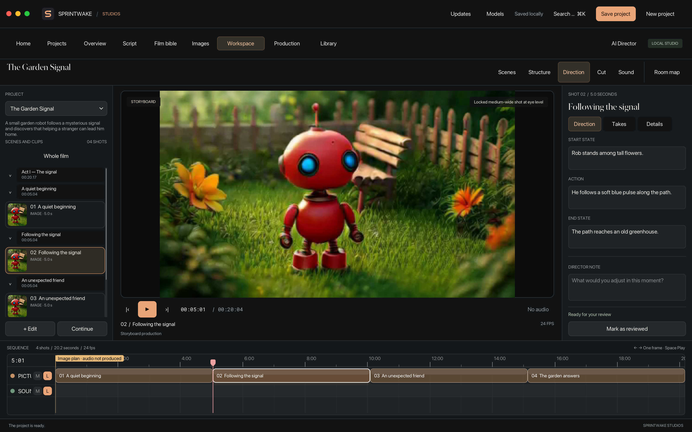
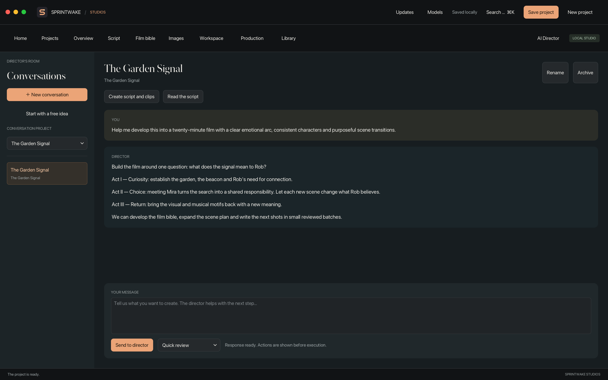
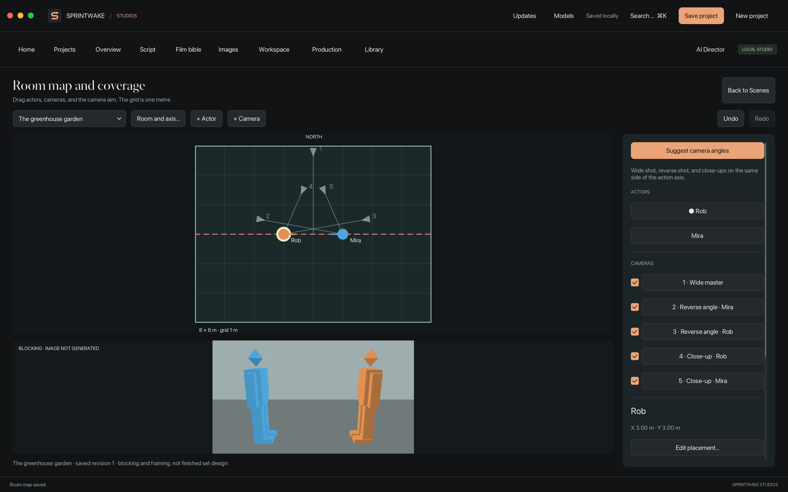

# Sprintwake Studios

**Make long-form films with a built-in AI director — and run the entire creative workflow locally.**

Sprintwake Studios is a native macOS film studio for turning an idea into a script,
cast, scenes, generated images and video, an editable cut, sound and a finished export.
Build a longer story scene by scene, keep continuity, and resume production from saved
checkpoints instead of starting over.

**Local or cloud models — your choice.** Connect cloud-hosted language models
through supported API profiles, and image/video workflows through compatible remote
ComfyUI services. You can also run entirely locally. See [supported connections
and workflow limits](MODEL_CONNECTIONS.md); full-film continuation currently uses
the native local Qwen/LTX workflow.


*The native film workspace: scene outline, storyboard preview, shot details and an editable timeline. Demo project shown.*

## Install and run from source

**Apple Silicon · macOS 14 or later · Apple's Command Line Tools · [uv](https://docs.astral.sh/uv/getting-started/installation/)**

```sh
git clone https://github.com/oddmundleikvoll/sprintwake-studios.git
cd sprintwake-studios
./scripts/setup.sh
open "dist/Sprintwake Studios.app"
```

The build produces a standalone app in `dist/`. **Local builds do not require a
Developer ID certificate or notarization.** Setup downloads pinned development/runtime
dependencies; it does not download model weights or start generation.

To install the built app in your Applications folder:

```sh
.venv/bin/python -B scripts/install_app.py install \
  "$HOME/Applications" "$PWD/dist/Sprintwake Studios.app" \
  "$HOME/Applications/Sprintwake Studios.app"
open "$HOME/Applications/Sprintwake Studios.app"
```

Then open **Models** (the **Models and connections** panel), choose a production folder, and connect your
local or cloud-hosted model services. The app includes its production engine, Python CPU runtime and
FFmpeg. **Model weights and inference services are installed separately.** See
[model setup and supported profiles](MODEL_CONNECTIONS.md).

## What makes it a film studio?

- **Long-form filmmaking.** Plan a complete story, divide it into scenes and shots,
  maintain a cast/location/prop bible, review continuity, and resume generation at
  saved checkpoints. Longer films are built from connected shots, with explicit
  image-plan and video/audio review gates.
- **A built-in AI director.** Develop an idea in conversation, propose a project,
  write a script and shot cards in bounded batches, and inspect saved editing
  decisions. Review changes before applying them; generation remains an explicit action.
- **A fully local workflow.** Use locally hosted language, image and video models.
  Keep projects, media and credentials on your Mac. No cloud account is required
  for a local setup; optional external providers can also be connected.
- **Cloud connections when you want them.** Use supported hosted language-model
  APIs for the director and remote ComfyUI image/video profiles for independent
  takes. Provider and workflow capabilities determine what each connection supports.
- **Editing without regeneration.** Select retained takes, trim and reorder shots,
  arrange scenes, set runtime goals and undo changes while preserving original media.
- **Sound across cuts.** Work with separate dialogue, music, ambience and effects
  lanes, source trims, fades, gain and mute/solo controls.
- **Native tools throughout.** AVFoundation playback with audio, reference galleries,
  room/camera blocking, a shared player and timeline, and project exports.


*The director works with the same project as the editor. This screenshot uses a scripted demo conversation; no model was run.*


*Block a scene, inspect framing and choose camera angles before requesting new media.*

## Your first film

1. Open **Film Studio** and start with the **AI Director**, or create a project directly.
2. Develop the script and film bible: characters, locations, props and reference images.
3. Plan useful camera views with a clear opening, action, ending and sound. Track
   positions, eyelines, costume and prop ownership before and after each shot.
4. Prepare and review the image plan, then explicitly request production.
5. Watch each required shot with audio, compare its actual ending to the next
   planned opening, and record observations before resuming.
6. Refine the cut and sound, then export the finished movie or a portable project ZIP.

The Start page also offers **Create an image** and **Create a clip** for smaller work.
Opening a studio or editing an existing cut does not start model inference.
The interface is English; project text and dialogue can use your chosen language.

## Model support and current scope

The native full-film/continuation path uses **Qwen-Image-2.1-Turbo in ComfyUI + LTX-2.5 Q8 through the MIT `ltx-2-mlx` CLI**. Install the independent Comfy memory-barrier plugin and configure the local CLI/model pack as described in [engine setup](engine/README.md). The app does not bundle those inference installations or weights. The director can use a supported local or
cloud-hosted language service; model quality, memory requirements and generation
speed depend on your setup.

Explicit API-exported ComfyUI image/video profiles support independent takes with
saved recipes. Arbitrary workflows do not automatically gain native continuation,
long-film resume or every reference/audio capability. See
[MODEL_CONNECTIONS.md](MODEL_CONNECTIONS.md) for the supported contract and limits.

Long-form planning, resumability and review are implemented. The independent 0.11 engine is verified with CPU/API fixtures and the real native interface; it has not been qualified by generating a new film. Synthetic tests do not establish model quality or feature-film runtime.

Version 0.11.2 adds role-labelled references, planned physical-state handoff,
scene coverage guidance, speaker/delivery controls and retained human review
notes. Automated tests and model generation were intentionally deferred for this
update. Existing image plans require
explicit preparation and review under the new direction version; prior production
journals, media and recipes are retained.

## Build, develop and contribute

For development, `./run.command` launches directly from the checkout. To verify:

```sh
./scripts/check.sh
./run.command --smoke-test
```

The smoke test uses disposable projects and synthetic media, with no model inference.
Setup preserves existing build outputs; choose a fresh `RAVEN_PACKAGE_OUTPUT` for
subsequent builds. See [CONTRIBUTING.md](CONTRIBUTING.md) for the development workflow
and [DISTRIBUTION.md](DISTRIBUTION.md) for installation, signing and updates.

Projects and private settings stay outside the app. The default production location
is `~/Movies/Raven Studio`; credentials use the macOS Keychain. App updates replace
the application while preserving production data and model installations.

## License and project status

Sprintwake's current application and independently authored production engine use the **[MIT License](LICENSE)**, which permits commercial use of that code. The earlier CC BY-NC-SA engine and copied contracts have been replaced. Historical versions keep their original terms. Dependencies, model weights and hosted providers retain their own licenses; see [NOTICE.md](NOTICE.md) and [replacement provenance](CC_REPLACEMENT.md).

[Changelog](CHANGELOG.md) · [Project scope](PROJECT.md) · [Verification and history](STATUS.md) ·
[GitHub CI](https://github.com/oddmundleikvoll/sprintwake-studios/actions/workflows/ci.yml)

Prebuilt Mac releases and signed updates are a separate distribution step. You can
build and use the app locally from this repository today.
